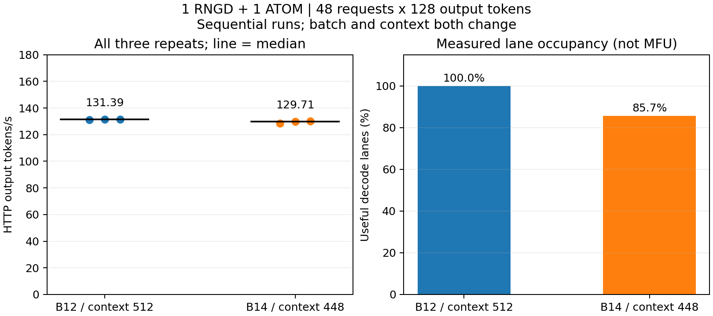
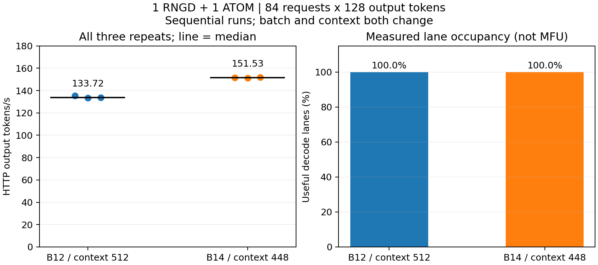

# B14/context448: 메모리 제한 안에서 배치 확대

KONI 8B의 1 RNGD prefill + 1 ATOM decode 경로에서 B12보다 큰 배치를 실행하기 위한 실험이다. 기본 context512 경로는 유지한다. B14/context448은 명시적으로 선택하는 실험 설정이며 48요청의 전체 PD 검증은 완료했고, 84요청 비교도 완료했다.

## 메모리에서 확인한 사실

- B16/context512는 eager KV 할당에 실패했다.
- B16/context400·416은 attention 컴파일에 실패했다. 단일 attention 진단에서도 실패했고 448·512는 컴파일됐다. 이를 모든 모델의 정렬 규칙으로 일반화하지 않는다.
- B16/context448은 전체 컴파일에 성공했지만 KV64개 중60개를 할당한 뒤 실패했다. decode와 DMA는 시작하지 않았다.
- B14/context448은 전체 컴파일, eager KV 할당, decode 실행에 성공했다.

B16/context448의 런타임만 약14.1GiB를 사용했다. compiler Kernel 분류는15,011,414,016bytes이고, 선택된 층·norm·lm_head의 가중치를2bytes로 환산하면15,009,849,344bytes다. 대부분 가중치라는 해석을 지지하지만 compiler 내부 버퍼 구성을 직접 확인한 것은 아니다. 중복 KV를 제거하면 해결된다는 주장은 아직 근거가 없다.

B14/S448 외부 KV의 논리 FP32 할당은1.53125GiB다. P2P가 쓰는 물리 DLFloat16 배치의 크기와 같다고 가정하지 않는다. 버퍼 export는 live allocation 기록으로 소유권과 범위를 검증하고, 목적지 head stride는448×128×2bytes를 사용한다.

## Decode 단독 진단

4개 한국어 입력140/167/227/271토큰, 출력128, B14 슬롯에 순환 배치했다. 입력 빈도는4/4/3/3이다. warmup1회 뒤 측정3회는157.538/157.023/157.921tok/s, 중앙157.538tok/s였다. host KV admission은 이 decode 시간에 포함되지 않는다.

4회 모두 기존 B12/full/context512 host-reference와 전체 logits가 일치했다. 자체 생성 이력에 대한 독립 HF FP32 검사에서는510/512위치의 다음 토큰이 일치했고 최대 logit regret은0.03691673이었다. 4입력의 수치 진단이며 응용 품질 비열등성 증거는 아니다.

기존 B12/full decode144.151tok/s보다 높지만 batch/context/입력빈도와 실행 시점이 다르므로 배치 확대만의 효과로 확정하지 않는다.

## P2P 검증과 비교 설계

B14 초기 probe32요청에서 요청마다64/64 DMA CQE가 정상 완료됐고, 완료된 iteration은 같은 B14 그래프의 host 기준과 full-logit exact였다. 전체 반복 시험 및 종료 결과는 아래 최종 결과에 기록했다.

첫 비교는 기존과 같은48요청이다. B12는12×4, B14는14+14+14+6이므로 B14의 마지막 부분 배치 비용을 포함한다. 후속84요청 비교는12×7과14×6으로 두 구성 모두 배치를 채울 수 있다. 두 구성에 queue_capacity96과 동일 입력·출력·워밍업을 적용한다. context도 달라지는 구성 전체의 비교이며 순수 batch ablation은 아니다.

MFU, 연속 전력, client token-interval p99, 단독 NPU 대비 이득은 이 decode 진단이나 초기 probe로 입증되지 않는다.

실행 명령 및 실패를 포함한 원본 위치: ../../experiments/2026-10-16-b14-context448.md, ../../experiments/2026-10-16-b16-context400.md.

## 48요청 최종 결과

3회128.343/129.706/130.142tok/s, 중앙129.706tok/s. 224요청 전체 full-logit exact, 소유권 위반0, 모든 요청64/64CQE 정상, 서버/worker 정상종료. 실제 lane 점유85.714%였다. 기존 B12/full ABBA 요약131.730tok/s보다 낮아 이48요청 조건의 개선은 확인되지 않았다. 서로 다른 프로세스 실행 시점의 비교이며 후속84요청 비교가 필요하다. 원본 results/pd-b14-s448-r1/analysis.json.

그림의 B12는 가장 가까운 완료 full 실행(proj-abba-4-full)의3회 중앙131.390을 사용했다. 앞서 보고한131.730은 두 full 프로세스의 중앙값 요약이므로 집계 범위가 다르다. B14는 pd-b14-s448-r1의3회다. 원본별 전 반복을 표시했고 최대값을 선택하지 않았다.

## 84요청 최종 비교

| 구성 | 3회 tok/s | 중앙값 | 실제 lane 점유 |
|---|---|---:|---:|
| B12/context512/full |135.313 / 133.469 / 133.715|133.715|100%|
| B14/context448/full |151.528 / 151.235 / 151.744|151.528|100%|

동일84요청×출력128, 워밍업도84×128, queue96에서 B14가13.32% 높았다. 각368요청, 합계736요청 전체 same-artifact host/P2P logits exact, 소유권 위반0, 모든DMA완료, 양서버/worker 정상종료. 각구성1프로세스·3반복의 순차실행으로 통계적 유의성이나 일반 부하 우위를 주장하지 않는다.

48요청에서는 B14의 이득이 없었다는 결과도 유지한다. 다음 최적화 기준으로 B14는 context448 안의 충분한 긴출력 부하에 명시적으로 사용하고, 일반 기본값은 변경하지 않는다. 실행순서 교차 재현 및 혼합길이·실제도착률·전력·SLO 검증이 남아 있다.

[기계 판독 비교](b12-b14-saturation84.json). 원본 results/pd-b12-sat84-r1 및 results/pd-b14-sat84-r1.
