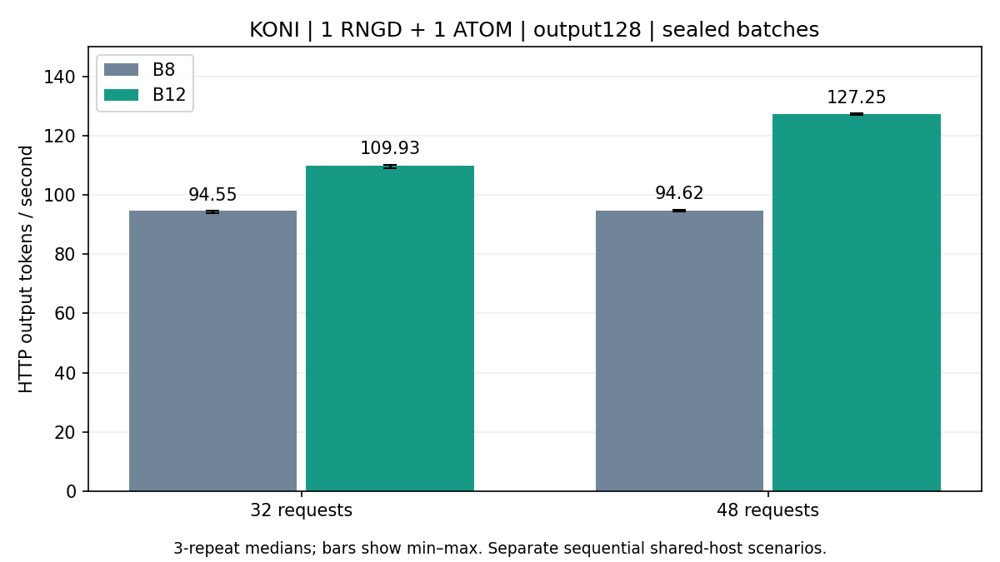

# B8/B12 48요청 비교

KONI/context512, 1 RNGD+1 ATOM2, 입력140/167/227/271, 출력128, sealed 정책,48요청,3회 반복. lookahead32/collection20ms/initialwait100ms. B8 이후 B12 순차실행한 공유호스트 시험이며 통계적유의성/일반서비스전체의 우위를 주장하지 않는다.

| Batch | 처리량 중앙값 | 반복 범위 | 실제 유효lane |
|---|---:|---:|---:|
| B8 |94.621tok/s|94.338–94.995|100%|
| B12 |127.249tok/s|127.077–127.447|100%|

같은48요청에서 **34.48% 증가**. 출력토큰합계/HTTP전체경과시간이며 prefill, P2P, 대기, decode 포함. EOS무시/non-streaming/전체logits검증 포함. B8은8개씩6배치, B12는12개씩4배치였음을 이벤트로 확인했다.

B8 202요청, B12 224요청(서로다른probe수 포함), 측정은각144요청. 모두 같은batch host 기준logits exact/소유권위반0/DMA완료. 서버·worker·sidecar 정상종료.

이전32요청 비교는 B12의마지막8/12부분배치를 포함하므로 별도 결과로 유지한다. 요청수·동시성이 바뀌었으며32→48변화를 부분배치효과만으로 단정하지 않는다. Lane비율은MFU가 아니다. 전력/응용품질/SLO는미평가.

[반복별 수치](b8-b12-saturation48.json). Raw: results/pd-b8-sat48-r1, results/pd-b12-sat48-r1. 실행명령: ../../experiments/2026-10-16-b8-b12-saturation48.md.

오차막대는3회최솟값~최댓값이며신뢰구간이아니다. 생성: `python3 examples/koni/plot_batch_saturation.py --docs docs`.
