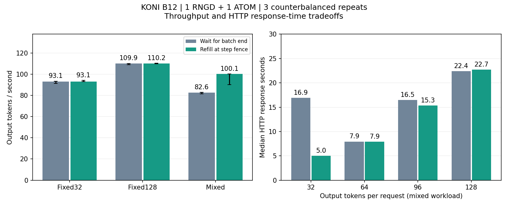

# B12 PD HTTP 실측

2026-10-16, 1 RNGD + 1 ATOM2, KONI/context512. 입력140/167/227/271, 출력고정/EOS무시, non-streaming. 각 조건32요청,3회 반복 중앙값. 전체 logits 검증 비용 포함.

| 조건 | sealed tok/s | refill tok/s |
|---|---:|---:|
| fixed32 | 93.107 | 93.067 |
| fixed128 | 109.930 | 110.165 |
| mixed32 | 82.638 | 100.130 |

640요청 모두 같은 B12 host 기준의 전체 logits exact. 사건 재생으로 소유권 위반0, 실제refill80건, 요청별64/64 CQE를 검증했다. DMA 중앙값2.985ms. 서버·worker 정상 종료.

고정32요청은12+12+8로 실행되어 lane 사용비율88.89%다. MFU나 시스템 활용률이 아니다. 혼합 refill은sealed 대비 약21.2% 높지만 동일32요청 B8 비교는 [후속 비교 보고서](B8_B12_COMPARISON_KO.md)에 기록했다. 네 입력 반복이며 응용품질/전력/SLO는 이번에 평가하지 않았다.

B12 eager runtime은15.6/15.7GiB를 관측해 메모리 여유가 작다. B16 eager 실패는 별도 보존했다. B8과의 bitwise 일치를 품질 기준으로 강제하지 않으며 같은 batch host/P2P 전송 검증과 독립FP32 품질진단을 구분한다. 후속 독립 FP32 수치진단 결과는 아래에 기록했다.

[원시 요약](b12-iteration-validation.json). Raw: results/pd-b12-r1; 설정/소스snapshot/patch/실행기록 보존. 실행 명령은 ../../experiments/2026-10-16-b12-pd-http.md.

## 반복 변동과 길이별 지연

혼합 처리량의3회 값은 sealed81.498/82.638/82.831, refill90.145/100.303/100.130tok/s였다. refill에서도 변동이 남으므로 최대값을 대표값으로 선택하지 않는다. 혼합 유효lane 비율은66.67%→80.00%였다.

| 출력 길이 | sealed HTTP 응답 중앙값 | refill HTTP 응답 중앙값 |
|---|---:|---:|
|32|16.907초|4.984초|
|64|7.939초|7.922초|
|96|16.475초|15.341초|
|128|22.388초|22.696초|

대기시간을 포함한 non-streaming 응답시간이며 TPOT가 아니다. 짧은 요청은 빨라졌으나 긴 요청은 소폭 느려졌다.

오차막대는3회 최솟값~최댓값이며 신뢰구간이 아니다. 재생성: `python3 examples/koni/plot_iteration.py docs/b12-iteration-validation.json docs/b12-iteration-comparison.png`.

## 독립 FP32 수치 검사 완료

B12 자체 생성 이력에서 HF FP32 eager CPU와 다음토큰506/512개 일치(4입력×128위치). 최대 logit regret0.17534256. 같은이력에서의 수치진단이며 응용정확도·품질비열등성 증거는 아니다. 다른batch의 서로다른이력 top1을 직접 품질순위로 비교하지 않는다. [결과](b12-fp32-quality.json). 원본 experiments/native_pd_2026_4/b12_feasibility_20261016/hf-quality-own.

## Decode step 구간 계측

Eager B12, warmup1+measured3×128step, 같은 B12 host 기준 exact 검증 통과. Decode-only 처리량 중앙값138.394tok/s. Host wall 구간 평균: 준비0.225ms, 입력전송0.853ms, runtime호출83.849ms, 출력회수1.060ms, 전체85.987ms. 비동기 device작업은 뒤 구간에 포함될 수 있으며 kernel profiler 값이 아니다. 추가 fence를 넣지 않았다.

작은 입력 준비·출력 회수만 줄이는 최적화의 직접 여지는 제한적으로 보인다. 우선 같은 B8/B12가 모두 채워지는48요청 시험으로 마지막 부분배치 비용과 포화처리량을 분리할 예정이다. [계측 요약](b12-step-profile.json).
