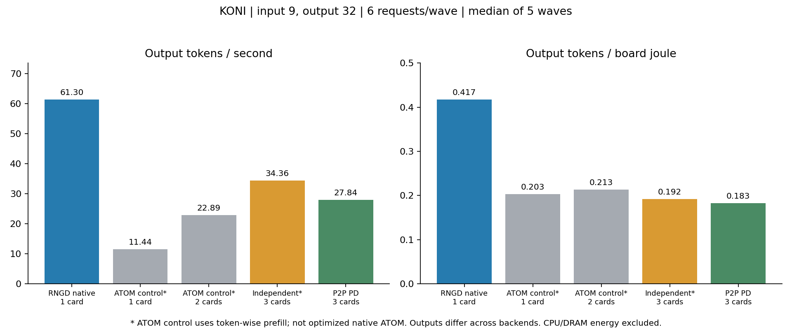

# 단독 NPU·독립 서빙·이종 PD 비교

동일 KONI revision, 동일9토큰 입력·32토큰 출력, wave당6요청, 준비2회·측정5회로 비교했다. 아래 수치는 최적화된 모든 단독 구현을 망라하는 결과가 아니다.

|방식|카드 구성|출력 tok/s|출력 tok/J|할당 보드 평균 W|
|---|---|---:|---:|---:|
|RNGD 네이티브 단독|RNGD1|61.30|0.417|146.74|
|ATOM 통제 단독*|ATOM3|11.44|0.203|56.28|
|ATOM 통제 독립2장*|ATOM2·3|22.89|0.213|107.18|
|RNGD+ATOM 독립 서빙*|RNGD1+ATOM2·3|34.36|0.192|179.23|
|이종 P2P PD|RNGD1+ATOM2·3|27.84|0.183|152.50|

## 현재 조건의 결론

RNGD 네이티브 단독은 PD보다 처리량 약2.20배, 보드 전력효율 약2.29배였다. 같은3개 보드의 고정 배분 독립 서빙도 PD보다 처리량 약23.4% 높았다. 현재 짧은 입력 조건에서 PD의 우위는 확인되지 않았다. ATOM 통제2장보다 PD의 처리량은 높지만, 추가 RNGD 전력을 포함하면 에너지 효율은 낮다. 출력 품질 동등성과 최적화된 ATOM 단독 기준이 미확인인 점은 아래 제한을 따른다.

## 해석상 필수 제한

- ATOM 통제 기준은 PD와 같은 B1 external decoder로 입력을 한 토큰씩 처리한다. 최적화된 chunk-prefill/vLLM 단독 구현이 아니다. 따라서 PD가 이 기준을 이겨도 ATOM 최적 단독 실행 대비 우위를 입증하지 않는다.
- 기존 ATOM vLLM 아티팩트는4장용이며 이번2장 범위에서 실행하지 않았다.
- 독립3장 방식은 보드마다2요청씩 고정 배분한다. 가장 빠른 보드로 몰아주는 적응형 라우팅을 최적화하지 않았다.
- RNGD 네이티브와 커스텀 PD의 greedy 출력이 다르다. 같은 길이 요청의 처리량 비교이며, 품질 동등성이 확인된 비교가 아니다. summary.json의 quality에 토큰별 증거와 반복 안정성을 기록했다.
- 외부 호스트의 다른 사용자 작업을 강제 종료하지 않았다. 측정 순서를 교대했으나 모드별 모델 구현·런타임과 초기화가 다르다.
- 에너지는 각 wave 시작부터 마지막 요청 완료까지 해당 방식에 할당한 보드 센서 전력을 적분했다. 유휴 시간도 포함하고 CPU/DRAM은 제외했다. 센서 표본이 구간 양끝을 감싸지 않으면 집계를 거부한다.
- 단독 및2장 모드에는 사용하지 않는 보드 전력을 분모에 넣지 않았다. 별도로 모든3장 보드의 에너지도 원시 집계에 보존했다.
- 요청6개를 동시에 도착한 것으로 보고 TTFT를 wave 시작부터 계산했다. 작은 표본의 p99를 서비스 SLO 달성 증거로 사용하지 않는다.

## 재현 자료

protocol.json, worker.py, run.py, 각 runs 디렉터리의 manifest·waves·power 로그, PD r59의 producer·worker·manifest·waves·power 로그에 기록했다. 집계: `PYTHONPATH=rngd_llmd/src python3 experiments/native_pd_2026_4/solo_pd_comparison_20261015/analyze.py`.

현재 조건의 결론은 표의 처리량과 전력효율에 한정한다. 더 긴 입력·혼합 도착·동일 품질 조건으로 일반화하려면 별도 시험이 필요하다.
